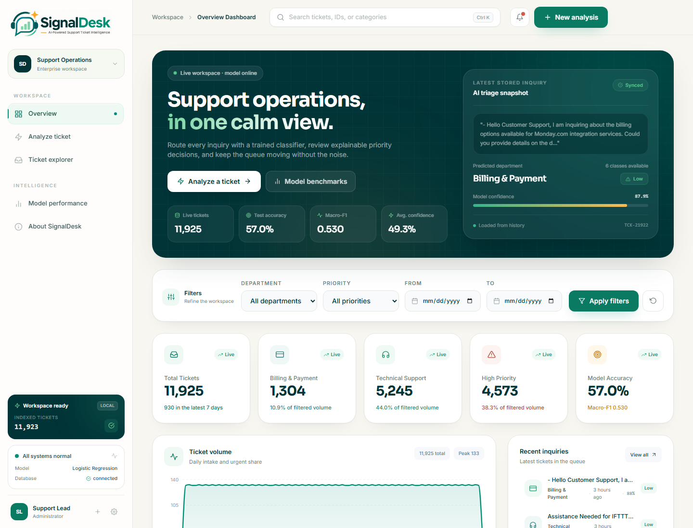
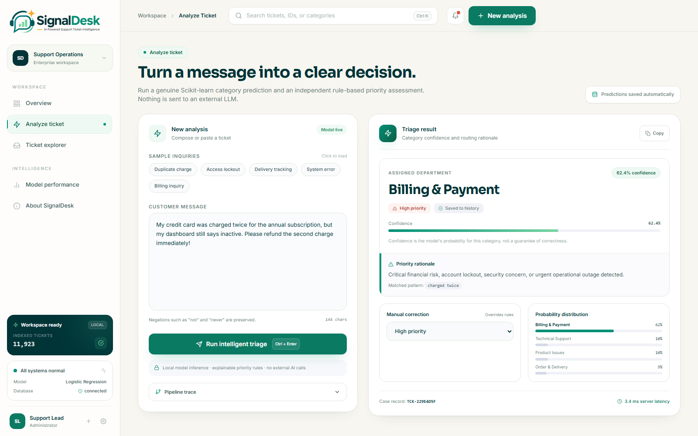
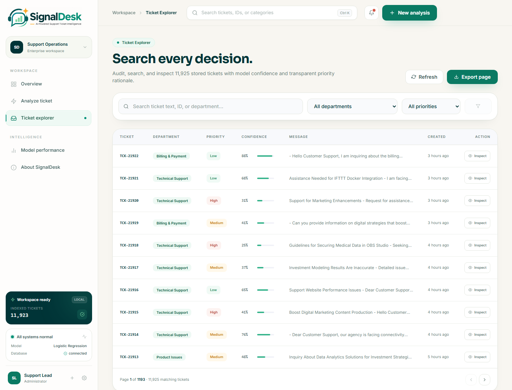
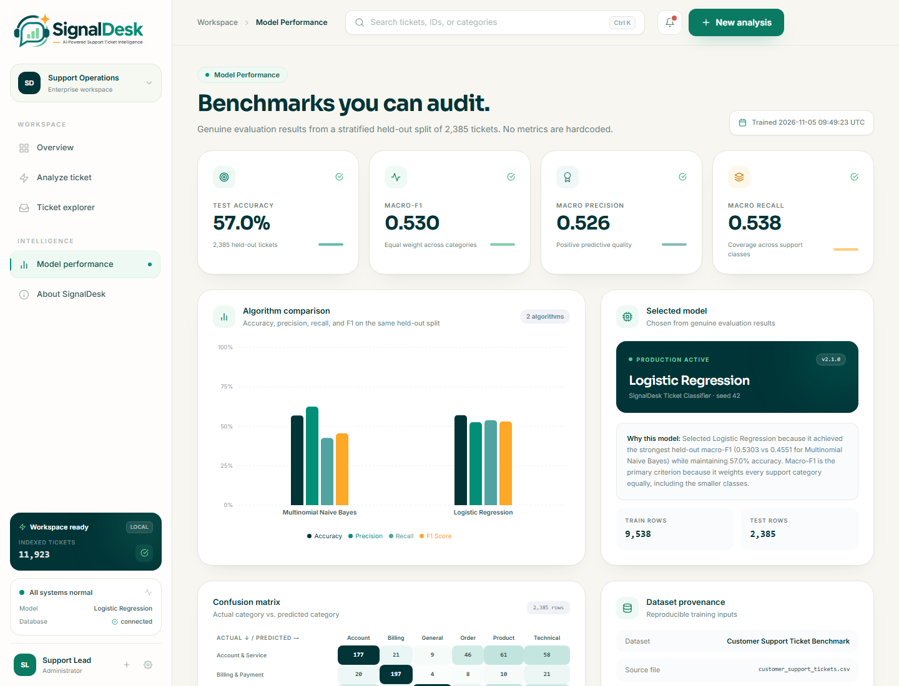
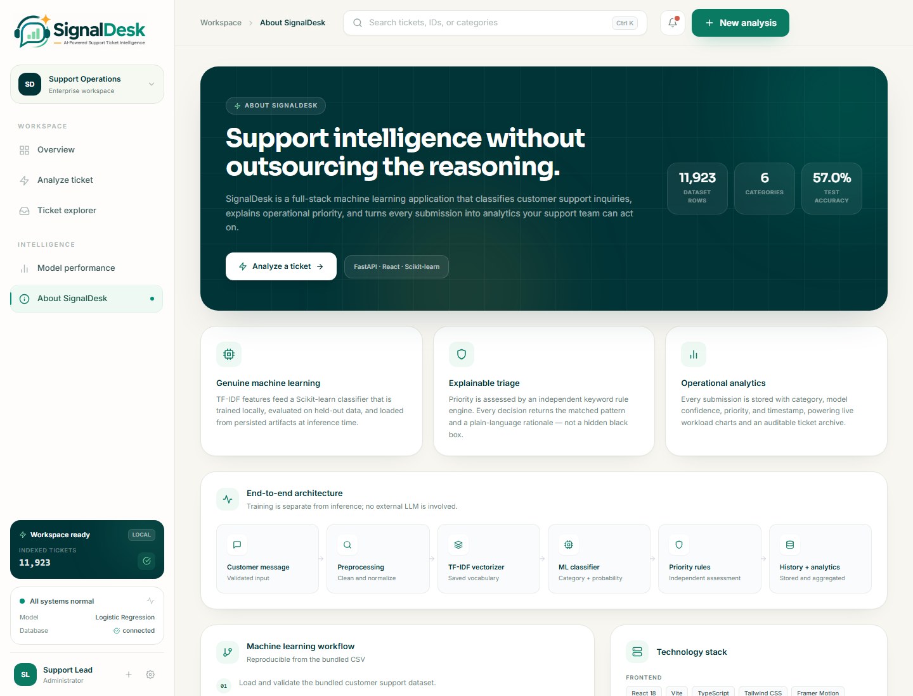
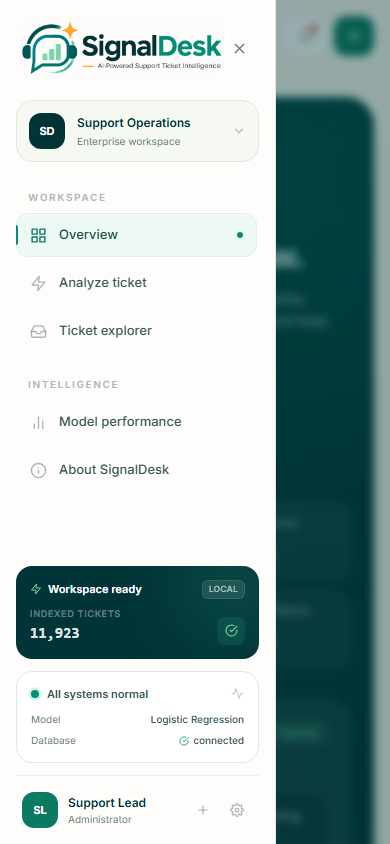
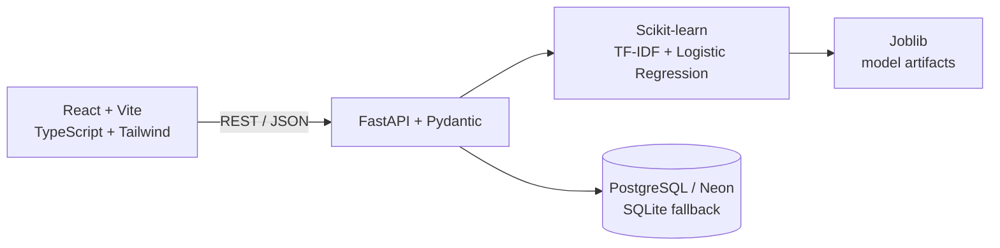

<div align="center">
  

  <h3>AI-Powered Support Ticket Intelligence</h3>

  <p>
    SignalDesk classifies support inquiries into six departments, explains operational
    priority, and turns every submission into workload analytics — with a genuinely
    trained Scikit-learn model and an auditable React dashboard.
  </p>

  <p>
    
    
    
    
  </p>

  <p>
    
    
    
    
    
    
    
    
  </p>
</div>

---

## ✨ What It Does

- 🧠 **Classifies support tickets** into six departments using a trained TF-IDF + Logistic
  Regression pipeline.
- 🚦 **Assesses priority** with an independent, explainable keyword rule engine. Priority is
  deliberately not a second ML prediction.
- 🗂️ **Stores every submission** with model confidence, priority reason, status, and timestamp.
- 📊 **Aggregates live analytics** with category, priority, and date filters.
- 🔍 **Exposes evaluation evidence**: accuracy, macro precision/recall/F1, per-class metrics,
  confusion matrix, algorithm comparison, and dataset provenance.

## 🖼️ Product Tour

<p align="center">
  <a href="docs/screenshots/overview.png"></a>
</p>
<p align="center">
  <sub><b>Overview</b> · live KPIs, filters, and workload trends</sub>
</p>

<p align="center">
  <a href="docs/screenshots/analyze.png"></a>
</p>
<p align="center">
  <sub><b>Analyze</b> · live category prediction, confidence, priority rationale, and probability distribution</sub>
</p>

<p align="center">
  <a href="docs/screenshots/explorer.png"></a>
  <a href="docs/screenshots/performance.png"></a>
</p>
<p align="center">
  <sub><b>Explorer</b> · search, audit, and export &nbsp;&nbsp; <b>Performance</b> · metrics you can inspect</sub>
</p>

<p align="center">
  <a href="docs/screenshots/about.png"></a>
</p>

<p align="center">
  <a href="docs/screenshots/mobile.png"></a>
</p>
<p align="center">
  <sub><b>About</b> · architecture and provenance &nbsp;&nbsp; <b>Mobile</b> · responsive shell and navigation</sub>
</p>

## 🏗️ Architecture



Frontend routes use hash navigation: `#/overview`, `#/analyze`, `#/explorer`,
`#/performance`, `#/about`.

## 🧠 Machine Learning Pipeline

Training is reproducible from the bundled CSV:

1. Load and validate the dataset.
2. Clean text: lowercase, strip HTML/URLs, remove stopwords while preserving negations,
   and lemmatize.
3. Create a stratified 80/20 train/test split (`random_state=42`).
4. Fit TF-IDF on the training split only (`max_features=20,000`, `ngram_range=(1, 2)`,
   `min_df=2`, `max_df=0.95`, `sublinear_tf=True`) to prevent leakage.
5. Train two candidates: Multinomial Naive Bayes and class-balanced Logistic Regression.
6. Select by macro-F1, then persist the model, vectorizer, and metadata.

### Verified Results

Held-out evaluation on 2,385 tickets:

| Model | Accuracy | Macro Precision | Macro Recall | Macro-F1 |
|---|---:|---:|---:|---:|
| **Logistic Regression (selected)** | **0.5702** | **0.5258** | **0.5385** | **0.5303** |
| Multinomial Naive Bayes | 0.5686 | 0.6246 | 0.4259 | 0.4551 |

Macro-F1 is the selection criterion because it weights every category equally, including
smaller classes. Metrics come from `backend/models/model_metadata.json`; nothing is
hardcoded in the UI.

### Dataset Provenance

- 📄 File: `backend/data/raw/customer_support_tickets.csv`
- 🔢 Rows: 11,923
- 🧾 Columns: `ticket_id`, `ticket_text`, `category`, `priority`, `created_at`
- 📅 Date range: 2026-08-07 to 2026-11-05
- ✅ No duplicate or null rows
- 🏷️ Categories: Technical Support (5,245), Product Issues (2,232), Account & Service (1,859),
  Billing & Payment (1,302), Order & Delivery (912), General Inquiry (373)

The bundled corpus is a benchmark-style support ticket dataset. It is not live customer
data, and its labels are noisy enough that 57% accuracy is the honest result. The UI and
documentation should not describe it as authentic production traffic.

## 🚦 Priority Rules

Priority is rule-based and returns the matched pattern plus a human-readable reason.

- **High**: outages, lockouts, security concerns, duplicate charges, fraud, refunds,
  cancellations.
- **Medium**: delivery delays, broken items, login issues, missing orders.
- **Low**: general questions, documentation requests, feature inquiries.
- **Default**: Low with an explicit "no urgent pattern matched" reason.

Agents can override a stored ticket's priority; the override is persisted with a reason.

## 🛠️ Tech Stack

| Layer | Technologies |
|---|---|
| 🖥️ Frontend | React 18, Vite, TypeScript, Tailwind CSS, Framer Motion, Recharts, React Icons |
| ⚡ Backend | Python 3.11+, FastAPI, Pydantic v2, Uvicorn, SQLAlchemy 2.0 |
| 🧠 Machine Learning | Scikit-learn, Pandas, NumPy, NLTK, Joblib |
| 🗄️ Database | PostgreSQL / Neon, SQLite fallback for local development |
| ☁️ Deployment | Vercel (frontend), Render (FastAPI Docker + PostgreSQL) |

## 📁 Project Structure

```
SignalDesk/
├── frontend/
│   ├── public/               # Logo, mark, and favicon
│   ├── src/
│   │   ├── components/       # Layout, dashboard cards, charts, UI primitives
│   │   ├── pages/            # Dashboard, AnalyzeTicket, TicketExplorer, ModelPerformance, About
│   │   ├── services/api.ts   # Typed Axios client
│   │   ├── types/            # Shared API contracts
│   │   └── lib/              # Formatting helpers
│   └── vite.config.ts
├── backend/
│   ├── app/
│   │   ├── api/routes/       # tickets, analytics, models, health
│   │   ├── core/config.py    # Environment settings
│   │   ├── database/         # Models, connection, repository
│   │   ├── ml/               # Preprocessing, data loading, features, evaluation, training
│   │   ├── schemas/          # Pydantic request/response models
│   │   └── services/         # Prediction, priority, analytics
│   ├── data/                 # Raw and processed data
│   ├── models/               # Joblib artifacts and metadata
│   ├── tests/                # unittest API and ML tests
│   ├── Dockerfile
│   └── requirements.txt
├── docs/screenshots/         # README product tour
├── assets/                   # Original brand artwork
├── render.yaml               # Render Blueprint (API + PostgreSQL)
├── PRD.md
└── README.md
```

## 🚀 Quickstart

**Requirements:** Python 3.11+ and Node.js 18+.

### 1. Backend

```bash
python -m venv .venv
# Windows: .venv\Scripts\activate
# macOS/Linux: source .venv/bin/activate

pip install -r backend/requirements.txt

# Optional: retrain and regenerate artifacts
python -m backend.app.ml.train_model

# Run the API
python -m uvicorn backend.app.main:app --host 0.0.0.0 --port 8000 --reload
```

- Swagger UI: `http://localhost:8000/docs`
- Health check: `http://localhost:8000/api/health`

By default the backend seeds all 11,923 dataset rows into the history store on first
startup. Set `SEED_MAX_ROWS=300` to seed a smaller demo history.

### 2. Frontend

```bash
cd frontend
npm install
npm run dev
```

- App: `http://localhost:5173`

Vite proxies `/api` to `http://localhost:8000`. Override with `VITE_API_BASE_URL` when
the backend is hosted elsewhere.

### 3. Docker (production parity)

The build context must be the repository root because the Dockerfile copies the
`backend/` directory:

```bash
docker build -f backend/Dockerfile -t signaldesk-api .
docker run --rm -p 8000:8000 -e SEED_MAX_ROWS=300 signaldesk-api
```

The container exposes the API at `http://localhost:8000/api/health`.

## ✅ Verification Checklist

Use this pass after both services are running.

| Route | What to verify |
|---|---|
| `#/overview` | KPIs are populated, department/priority/date filters apply and reset correctly, charts update, and recent tickets open the detail modal. |
| `#/analyze` | Sample inquiries load, short input is rejected, `Ctrl+Enter` and the triage button both work, and the result shows category, confidence, priority, rationale, and saved status. |
| `#/explorer` | Text/ID search, filters, pagination, inspect modal, and CSV export work against the stored history. |
| `#/performance` | Evaluation metrics, algorithm comparison, confusion matrix, selected model, and dataset provenance render from the API. |
| `#/about` | Architecture, workflow, and technology content render without layout issues. |
| App shell | Sidebar navigation changes routes, global search finds tickets, notifications open, and the mobile drawer works at phone width. |

Also confirm the SignalDesk logo appears in the sidebar, the favicon loads, and the
browser console has no errors or horizontal overflow at desktop and mobile widths.

### API Smoke Test

Swagger UI is available at `http://localhost:8000/docs`. The core endpoints are:

```text
GET  /api/health
GET  /api/analytics/overview
GET  /api/tickets?page=1&limit=5
POST /api/tickets/predict
```

Run a prediction directly with PowerShell:

```powershell
$body = @{
  ticket_text = "I was charged twice and need a refund urgently. This is a billing error."
  save = $false
} | ConvertTo-Json

Invoke-RestMethod -Method Post `
  -Uri "http://localhost:8000/api/tickets/predict" `
  -ContentType "application/json" `
  -Body $body | ConvertTo-Json -Depth 5
```

Expected result: `predicted_category` is `Billing & Payment`, `priority` is `High`,
`matched_pattern` is `charged twice`, and `saved` is `false`.

## 🧪 Tests

```bash
# All backend API and ML tests
python -m unittest discover -s backend/tests -p "test_*.py" -v

# Frontend typecheck and production build
cd frontend
npm run build
```

Backend tests use a separate SQLite database and seed 300 rows, so they do not modify the
local development history. The suite contains 18 tests covering health, analytics filters,
prediction, validation, priority overrides, artifact loading, preprocessing, vectorizer
leakage, and priority rules.

There is no frontend unit-test runner configured; use `npm run build` for TypeScript and
production-build validation, then run the manual checklist above in a browser.

## 📡 API Endpoints

| Method | Endpoint | Purpose |
|---|---|---|
| GET | `/api/health` | API, database, and model status |
| POST | `/api/tickets/predict` | Classify a ticket and optionally save it |
| GET | `/api/tickets` | Paginated ticket history with filters |
| GET | `/api/tickets/{id}` | Single ticket |
| PATCH | `/api/tickets/{id}/priority` | Manual priority correction |
| GET | `/api/analytics/overview` | Filtered KPIs, distributions, volume series |
| GET | `/api/analytics/dataset` | Dataset and training provenance |
| GET | `/api/analytics/categories` | Category distribution |
| GET | `/api/analytics/priorities` | Priority distribution |
| GET | `/api/analytics/recent-tickets` | Recent ticket history |
| GET | `/api/models/performance` | Full evaluation report |
| GET | `/api/models/metadata` | Raw model metadata |
| GET | `/api/models/status` | Lightweight model status |

`/api/analytics/overview` accepts `category`, `priority`, `start_date`, and `end_date`.

## ⚙️ Environment Variables

| Variable | Default | Purpose |
|---|---|---|
| `DATABASE_URL` | `sqlite:///./signaldesk.db` | PostgreSQL URL (Render/Neon) or SQLite path |
| `FRONTEND_URL` | `http://localhost:5173` | Additional allowed CORS origin |
| `SEED_MAX_ROWS` | `0` | Number of dataset rows to seed (0 = all 11,923) |
| `MIN_TICKET_LENGTH` | `4` | Minimum accepted ticket length |
| `PORT` | `8000` | Port used by the Docker container |
| `VITE_API_BASE_URL` | `/api` | Frontend API base URL (build-time in Vite) |

## ☁️ Deployment

The repository includes `render.yaml`, which creates a Render PostgreSQL database and a
Docker web service. You can apply it as a Blueprint or create the two resources manually.

### 1. Render PostgreSQL

1. In Render, choose **New → Postgres**.
2. Name it `signaldesk-db`, choose a region, PostgreSQL 16, and a plan.
3. After it is available, copy the **Internal Database URL**.

### 2. Render API

1. Choose **New → Web Service** and connect this GitHub repository.
2. Set **Language** to `Docker`, **Branch** to `main`, and **Root Directory** to `.`.
3. Set **Dockerfile Path** to `backend/Dockerfile`.
4. Set **Health Check Path** to `/api/health`.
5. Add these environment variables:
   - `DATABASE_URL` = the Render Postgres internal URL
   - `FRONTEND_URL` = `https://signaldesk.vercel.app`
   - `SEED_MAX_ROWS` = `0` (or a smaller value such as `300` for a light demo)
6. Deploy and wait for `/api/health` to report `"database": "connected"` and
   `"model_loaded": true`.

The service URL has the form `https://signaldesk-api.onrender.com`. The API base is
`https://signaldesk-api.onrender.com/api`.

### 3. Vercel Frontend

1. Import the same repository into Vercel.
2. Set **Root Directory** to `frontend`.
3. Use the Vite preset: build command `npm run build`, output directory `dist`.
4. Add `VITE_API_BASE_URL` = `https://signaldesk-api.onrender.com/api`.
5. Deploy, then update `FRONTEND_URL` in Render if you use a custom domain.

`VITE_API_BASE_URL` is read at build time. Redeploy the Vercel project after changing it.

### Docker build notes

Build from the repository root so `COPY backend/ ...` resolves correctly:

```bash
docker build -f backend/Dockerfile -t signaldesk-api .
```

Free Render web services spin down after inactivity. The frontend API client uses a
60-second timeout to allow for cold starts.

## ⚠️ Limitations

- Priority is rule-based, not a trained ML prediction.
- Model confidence is a probability, not a correctness guarantee.
- The bundled dataset is benchmark-style, not live customer data.
- No authentication, chat/email ingestion, or billing integration is included.
- Category quality depends on the labels in the dataset used for training.
- Render free web services spin down when idle, and free PostgreSQL instances are
  time-limited. Use paid resources for a persistent production deployment.

---

<div align="center">
  <sub>Built with FastAPI, React, and an honest 57% model.</sub>
</div>
